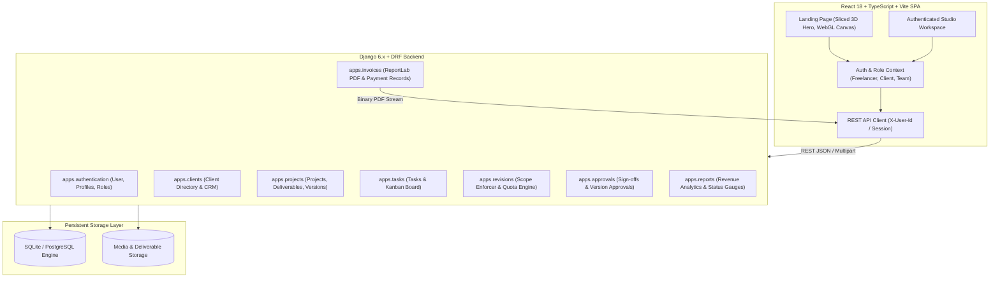
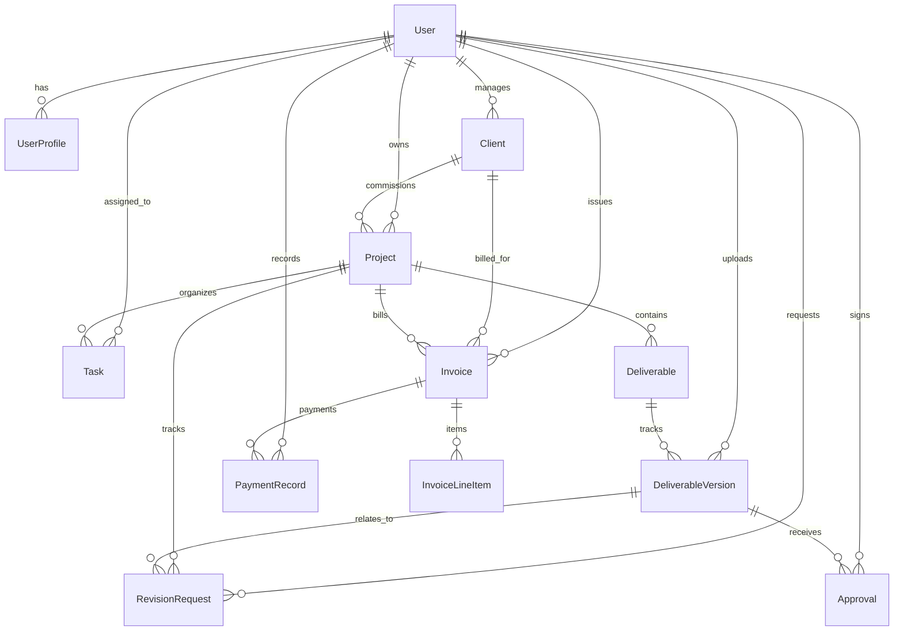

# CreativeFlow — Architectural Specification & System Design

CreativeFlow is a full-stack project management, revision tracking, and financial operating system engineered for freelance designers, creative directors, and boutique studios.

---

## 1. High-Level System Architecture

---

## 2. Entity Relationship Diagram (ERD)

---

## 3. Role-Based Access Control (RBAC) & Object-Level Permissions

| Role | Client Directory | Projects & Briefs | Task Kanban | Version Control | Revisions | Approvals | Invoices & PDF | Financial Reports |
|---|---|---|---|---|---|---|---|---|
| **Freelancer / Studio Lead** | Full CRUD + Archive | Full CRUD | Full CRUD + Drag & Drop | Upload & Manage Versions | Resolve / Reject | View Recorded Sign-offs | Generate, Edit, Record Payments | Full Studio Analytics |
| **Client** | Read Only (Own Record) | Read Assigned Projects | View Sprint Tasks | Review & Preview Files | Submit Change Requests | 1-Click Approve / Changes | View & Download PDF | Project-Specific Only |
| **Team Member** | Hidden | View Assigned Projects | Update Task Status | Upload Authorized Assets | View Revision Requests | View Approvals | Hidden | Workload View Only |

---

## 4. Revision Allowance & Scope Creep Protection Algorithm

1. Every `Project` has a configurable integer `revision_allowance` (e.g. `3`).
2. When a client submits a change request via `/api/v1/revisions/`, the backend computes active/consumed revisions:
   `consumed = project.revisions.filter(status__in=['in_progress', 'resolved', 'submitted']).count()`
3. If `consumed >= project.revision_allowance`:
   - The backend halts the request and returns `HTTP 400 Bad Request` with payload:
     `{"detail": "Revision allowance exceeded. Please contact freelancer to discuss additional revision scope.", "allowance_exceeded": true}`.
   - The client UI explains that the contracted rounds have been utilized and prompts an add-on discussion.

---

## 5. Invoicing & Precision Financial Calculations

- Invoices use Python `Decimal` data types throughout models and serializers, ensuring zero floating-point penny rounding errors.
- Line items calculate `line_total = (quantity * unit_price).quantize(Decimal('0.01'))`.
- Invoices calculate:
  $$\text{subtotal} = \sum \text{line\_total}$$
  $$\text{tax} = (\text{subtotal} \times \frac{\text{tax\_rate}}{100}).\text{quantize}(0.01)$$
  $$\text{total} = \text{subtotal} + \text{tax} - \text{discount}$$
  $$\text{balance\_due} = \max(0, \text{total} - \text{amount\_paid})$$
- Status is automatically updated:
  - If `amount_paid == 0`: `'sent'` or `'draft'`
  - If `0 < amount_paid < total`: `'partially_paid'`
  - If `amount_paid >= total`: `'paid'`
- Real-time PDF export is handled server-side using ReportLab (`SimpleDocTemplate`, `Table`, `ParagraphStyle`, and RGB hex brand styling).

